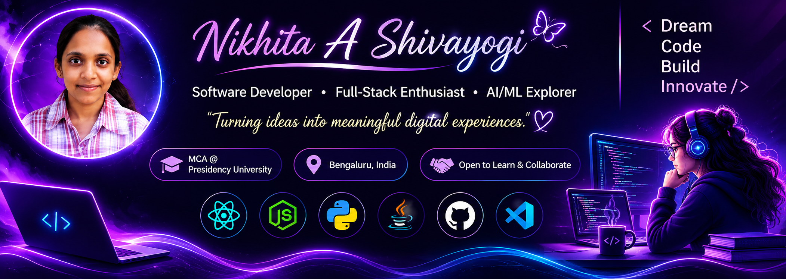

<!-- ==========================================================
     NIKHITA A SHIVAYOGI | GITHUB PROFILE README
     Theme: Purple Neon • Modern • Professional
========================================================== -->

 

  

---

## 💜 About Me

I'm **Nikhita A Shivayogi**, an aspiring Software Engineer currently pursuing my **Master of Computer Applications (MCA)** at **Presidency University, Bengaluru**.

I enjoy designing and developing full-stack applications, solving real-world problems through software, and exploring Artificial Intelligence and Machine Learning.

My approach is simple: **understand the problem, build a solution, keep improving.**

<table>
<tr>
<td align="center" width="33%">

### 03
**Deployed Projects**

</td>
<td align="center" width="33%">

### 01
**Internship**

</td>
<td align="center" width="33%">

### 04
**Certifications**

</td>
</tr>
</table>

---

## ⚡ Technical Arsenal

*Technologies I use to turn ideas into working applications.*

<table>
<tr>
<td width="27%" valign="top"><b>💻 Languages</b></td>
<td valign="top">

</td>
</tr>

<tr>
<td valign="top"><b>⚙️ Frameworks</b></td>
<td valign="top">

</td>
</tr>

<tr>
<td valign="top"><b>🌐 Web Technologies</b></td>
<td valign="top">

</td>
</tr>

<tr>
<td valign="top"><b>🗄️ Databases</b></td>
<td valign="top">

</td>
</tr>

<tr>
<td valign="top"><b>🤖 AI & ML</b></td>
<td valign="top">

 

Model Training & Evaluation

</td>
</tr>

<tr>
<td valign="top"><b>🛠️ Tools</b></td>
<td valign="top">

</td>
</tr>

<tr>
<td valign="top"><b>☁️ Deployment</b></td>
<td valign="top">

</td>
</tr>
</table>

<b>📚 Core Computer Science Concepts</b>

 

`Object-Oriented Programming` · `Data Structures` · `Software Development Life Cycle` · `Operating Systems` · `DBMS`

---

## 🚀 Featured Projects

### From Ideas to Deployed Applications

*Three applications built to explore real-world development challenges.*

 

<table>
<tr>
<td width="50%" valign="top">

<h3 align="center">🧠 MindQuest</h3>

<b>Personalized AI-Powered Learning</b>

An interactive learning and quiz platform combining AI-assisted content with performance analytics.

**Features**
- AI-assisted quizzes and MCQs
- User authentication
- Performance analytics
- Interactive learning interface

**Technologies**

`React` `Node.js` `Express.js` `MongoDB` `Gemini API`

</td>
<td width="50%" valign="top">

<h3 align="center">🏙️ CivicFix</h3>

<b>Smart Civic Issue Reporting</b>

A full-stack platform enabling citizens to report civic problems and monitor issue resolution.

**Features**
- Citizen, Authority and Admin roles
- Location-based issue reporting
- Image uploads and categorization
- Status tracking and notifications

**Technologies**

`React` `Node.js` `Express.js` `MongoDB`

</td>
</tr>

<tr>
<td width="50%" valign="top">

<h3 align="center">💰 StudentFlow</h3>

<b>Student Finance Tracker</b>

A student-focused web application for tracking income, expenses and financial records.

**Features**
- Income and expense management
- Transaction tracking
- Organized financial records
- Database-backed functionality

**Technologies**

`Python` `Flask` `MongoDB`

</td>
<td width="50%" valign="top">

<h3 align="center">✨ Explore More</h3>

<b>Learning Through Building</b>

I continuously work on projects exploring different areas of software engineering.

**Focus Areas**
- Full-Stack Web Development
- Python and Java Applications
- Artificial Intelligence
- Machine Learning
- Software Testing

</td>
</tr>
</table>

---

## 💼 Professional Experience

### Python Full-Stack Web Development Intern

**SkyllX** | February 2025 – April 2025

- Developed full-stack web applications using Python, HTML, CSS, JavaScript and MySQL.
- Implemented CRUD operations and database connectivity.
- Built responsive web interfaces.
- Gained hands-on experience in backend development and database integration.

**Technologies:** `Python` `HTML` `CSS` `JavaScript` `MySQL`

---

## 🎓 Education

| Degree | Institution | Duration |
|---|---|---|
| **Master of Computer Applications (MCA)** | Presidency University, Bengaluru | 2025–2027 · Pursuing |
| **Bachelor of Computer Applications (BCA)** | ARJ BCA College, Ilkal | 2022–2025 · CGPA: 9.0 |

---

## 🏆 Certifications

| Certification | Organization |
|---|---|
| Robotics | NPTEL |
| Introduction to Prompt Engineering for Generative AI | LinkedIn Learning |
| Python Programming | Reliance Foundation Skilling Academy |
| Full Stack Development | Udemy |

---

## 🌱 Currently Exploring

---

## 📊 GitHub Activity

  

---

## 🌸 Beyond Coding

| 📚 Learning | 🎬 Movies | 🔮 Mysteries | 💡 Technology |
|:---:|:---:|:---:|:---:|
| Exploring new knowledge | Watching new movies | Curious about the paranormal world | Discovering new ideas |

---

## 🤝 Let's Connect

### Have an idea or opportunity? Let's talk!

I'm interested in learning, collaborating, and exploring opportunities in software development.

 

  

### 💜 Learn • Build • Innovate

*Thank you for visiting my GitHub profile!*

