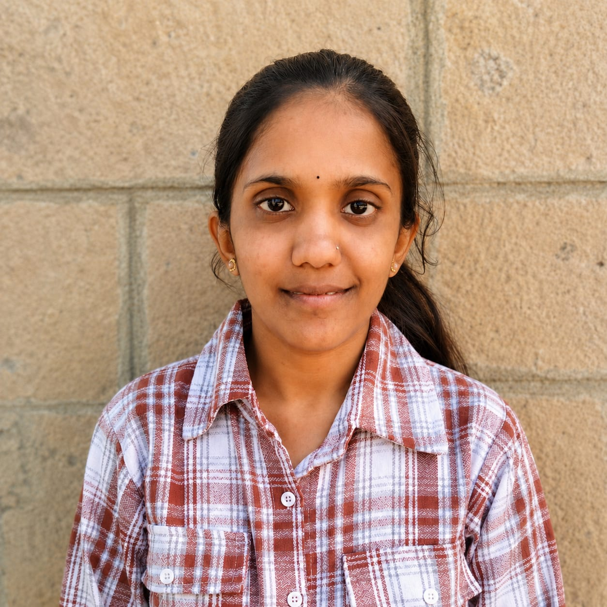

<!-- =========================================================
     NIKHITA A SHIVAYOGI — GITHUB PROFILE
     Modern • Minimal • Professional
========================================================= -->

 

  

# Nikhita A Shivayogi

### Software Developer  ·  Full-Stack Enthusiast  ·  AI/ML Explorer

**Turning ideas into meaningful digital experiences.**

 

  

`MCA @ Presidency University` &nbsp; • &nbsp; `Bengaluru, India` &nbsp; • &nbsp; `Open to Learning & Collaboration`

 

---

## 01. The Developer Behind the Code

I'm **Nikhita**, an MCA student at **Presidency University, Bengaluru**, with a passion for building practical software applications.

My interests span **full-stack web development, software engineering, artificial intelligence, and machine learning**. I enjoy exploring how different technologies come together to solve real-world problems.

I believe in learning by building — taking an idea, understanding the challenge, and transforming it into a functional application.

<table>
<tr>
<td width="33%" align="center">

### 03
**Deployed Projects**

</td>
<td width="33%" align="center">

### 01
**Internship Experience**

</td>
<td width="33%" align="center">

### 04
**Certifications**

</td>
</tr>
</table>

---

## 02. What I Work With

*My technical toolkit — from programming fundamentals to deployed applications.*

<table>
<tr>
<td width="28%" valign="top">

**LANGUAGES**

</td>
<td valign="top">

</td>
</tr>

<tr>
<td valign="top">

**FRAMEWORKS & RUNTIME**

</td>
<td valign="top">

</td>
</tr>

<tr>
<td valign="top">

**WEB TECHNOLOGIES**

</td>
<td valign="top">

</td>
</tr>

<tr>
<td valign="top">

**DATABASES**

</td>
<td valign="top">

</td>
</tr>

<tr>
<td valign="top">

**AI & MACHINE LEARNING**

</td>
<td valign="top">

 

`Model Training & Evaluation`

</td>
</tr>

<tr>
<td valign="top">

**DEVELOPER TOOLS**

</td>
<td valign="top">

</td>
</tr>

<tr>
<td valign="top">

**DEPLOYMENT**

</td>
<td valign="top">

</td>
</tr>
</table>

<b>Explore my computer science fundamentals</b>

 

`Object-Oriented Programming` · `Data Structures` · `Software Development Life Cycle` · `Operating Systems` · `Database Management Systems`

---

## 03. Selected Work

### Built with curiosity. Developed with purpose.

*Three deployed applications that reflect my development journey.*

 

<table>
<tr>
<td width="50%" valign="top">

### 01 — MindQuest

**AI-Powered Learning & Quiz Platform**

An interactive learning application combining quizzes, personalized learning experiences, and performance analytics.

**What it offers**
- AI-assisted quiz experience
- Interactive MCQs
- User authentication
- Performance tracking and analytics

**Stack**

`React` `Node.js` `Express.js` `MongoDB` `Gemini API`

</td>
<td width="50%" valign="top">

### 02 — CivicFix

**Civic Issue Reporting & Management**

A full-stack platform designed to help citizens report public infrastructure issues and follow their resolution.

**What it offers**
- Citizen, Authority & Admin roles
- Location-based issue reporting
- Image uploads and categorization
- Status updates and notifications

**Stack**

`React` `Node.js` `Express.js` `MongoDB`

</td>
</tr>

<tr>
<td width="50%" valign="top">

### 03 — StudentFlow

**Student Finance Management Application**

A student-focused application for managing income, expenses, and financial records.

**What it offers**
- Income and expense tracking
- Transaction management
- Financial record organization
- Database-backed functionality

**Stack**

`Python` `Flask` `MongoDB`

</td>
<td width="50%" valign="top">

### More from My GitHub

Beyond these featured applications, I explore different areas of software engineering and computer science.

**Areas I explore**

- Full-Stack Web Development
- Python and Java Applications
- AI & Machine Learning
- Reinforcement Learning
- Software Testing

</td>
</tr>
</table>

---

## 04. Professional Experience

### Python Full-Stack Web Development Intern

**SkyllX** &nbsp; | &nbsp; February 2025 – April 2025

Worked on practical web development projects, strengthening my understanding of application development and database integration.

- Developed full-stack applications using **Python, HTML, CSS, JavaScript, and MySQL**.
- Implemented **CRUD operations** and database connectivity.
- Built responsive web interfaces and applied backend development concepts.

**Technologies:** `Python` `HTML` `CSS` `JavaScript` `MySQL`

---

## 05. Academic Journey

| Qualification | Institution | Timeline |
|---|---|---|
| **Master of Computer Applications** | Presidency University, Bengaluru | 2025–2027 · Pursuing |
| **Bachelor of Computer Applications** | ARJ BCA College, Ilkal | 2022–2025 · CGPA 9.0 |

---

## 06. Certifications & Continuous Learning

| Learning Milestone | Issued By |
|---|---|
| Robotics | NPTEL |
| Introduction to Prompt Engineering for Generative AI | LinkedIn Learning |
| Python Programming | Reliance Foundation Skilling Academy |
| Full Stack Development | Udemy |

---

## 07. Beyond Development

I believe curiosity is an important part of becoming a better developer.

Outside programming, I enjoy **exploring new knowledge, watching movies, and discovering mysteries of the paranormal world**.

I'm also interested in learning about emerging technologies and finding new ways to apply them through software projects.

---

## 08. My GitHub

**Explore my repositories, contributions, and ongoing projects.**

 

  

---

## 09. Let's Build Something Meaningful

I'm interested in **software development opportunities, collaboration, and learning from the developer community**.

Whether it's a project idea, a technical discussion, or a professional opportunity, I'd be happy to connect.

 

  

### Learn. Build. Improve. Repeat.

Thanks for stopping by! 💜

